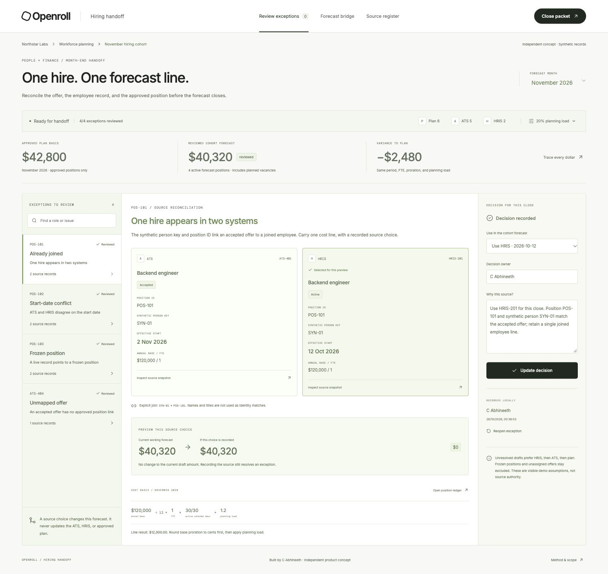

# Openroll Hiring Handoff

A working, independent product concept by C Abhineeth for the handoff between People Operations and Finance.

**One hire can appear in an accepted offer and an HRIS record. Two valid systems can disagree about when its cost starts.** This focused workbench reconciles those sources with an approved position plan before a hiring-cohort forecast is handed to Finance.



## Run locally

Requires Node.js 20.19+ or 22.12+.

```sh
npm ci
npm run dev
```

Open http://127.0.0.1:5186/.

```sh
npm test
npm run build
```

## The product workflow

1. Review four source exceptions: a joined employee still present in the ATS, conflicting effective dates, an accepted offer against a frozen position, and an offer without an approved position link.
2. Inspect the original source records. Synthetic person keys and explicit position IDs are used; titles do not establish identity.
3. Preview a source choice before recording it. For the start-date conflict, selecting the 16 November ATS date instead of the 1 December HRIS date adds $7,200 to the November working forecast under the demo assumptions.
4. Record an owner and rationale for the source used in this local close. Choosing a source does not update the ATS, HRIS, or position plan.
5. Link the unassigned offer to its explicitly chosen approved vacancy. It replaces the planned vacancy, rather than adding another forecast position.
6. Inspect the forecast bridge. It separately explains variance against the approved plan and reconciliation of overlapping source records.
7. Export an inspectable close packet or position-level CSV after every source exception has a recorded decision and the source bridge has zero unexplained residual.

Decisions and planning assumptions persist in browser localStorage. Reopening an exception removes its current local decision and blocks the packet until it is recorded again. A changed source snapshot invalidates decisions by content identity. The prototype retains the latest decision, not an immutable history of prior decisions.

## The synthetic scenario

The fictional Northstar Labs fixture contains six plan positions, five ATS records, and two HRIS records. Five positions are approved; one is frozen. The source view also contains planned vacancies for approved positions that have no matching live source record.

With a 20% illustrative planning load, and the reviewed choices in `examples/reviewed-decisions.json`:

- November approved plan: **$42,800**.
- November reconciled cohort forecast: **$40,320**.
- Variance to plan: **-$2,480**, explained by an earlier joined start (+$400) and a later offer start (-$2,880).
- December and January forecast: **$66,000 per month**.
- November raw source view: **$72,320**, intentionally retaining overlapping records.
- The source reconciliation bridge accounts for every difference between that raw view and the reconciled cohort. This delta is **not savings**.

The working draft initially uses HRIS ahead of ATS, excludes frozen positions and unmatched offers, and keeps approved vacancies in the plan. Those defaults are visible in the interface. They are demo assumptions, not a determination of source authority. Unresolved defaults do not satisfy the export gate.

## Calculation model

All source amounts are **USD annual full-time base amounts in integer cents**. FTE is stored in basis points. For each month:

```text
base cost = annual base / 12 × FTE × active calendar days / calendar days in month
period cost = rounded base cost × (1 + planning load)
```

Start dates are inclusive. Each line rounds its base proration to cents before applying the planning load, which also rounds to cents. Integer arithmetic uses BigInt ratios to avoid decimal floating-point errors. Month lengths, leap years, and the year boundary are tested.

Planning load is editable from 0% to 100%. It is an illustrative cost assumption, **not a statutory payroll tax rate**. This is a limited hiring cohort, not total company headcount or actual payroll. The model does not include terminations, transfers, multi-currency FX, equity, bonuses, jurisdiction-specific taxes, or actual payslips.

The position ledger, per-position budget drivers, raw-source adjustments, and exported packet expose the calculations. A packet with an unexplained source-bridge residual cannot be exported.

## What is implemented

- Deterministic reconciliation using explicit source references.
- Review queues for duplicate cross-system records, conflicting dates, frozen positions, unknown offer links, differing synthetic person keys, and multiple records in a source.
- One proposed cost line per approved position.
- Operator-selected source rules and position links; duplicate vacancy assignments are rejected.
- Source-choice preview, recorded rationale, reopening, and source-content invalidation.
- Monthly forecasting with FTE, calendar-day proration, planning load, and rounding.
- Plan-versus-forecast drivers and an exactly reconciled raw-source bridge.
- JSON close packets and CSV exports with quoted fields and explicit cents units.
- Editable synthetic snapshots with schema validation.
- Responsive layouts, keyboard focus containment, and Escape dismissal.

The local review gate is a demonstration, not authenticated approval, access control, or a tamper-resistant audit log. Browser state can be edited outside the UI. No employer, employee, candidate, or payroll record is changed.

## Why this fits Openroll

Research performed on October 28, 2026:

- [Openroll's current website](https://www.openroll.com/) describes an AI workspace across People and Finance systems, including headcount planning, cost forecasting, variance explanation, and auditable analysis.
- [Openroll's platform section](https://www.openroll.com/#platform) emphasizes ERP, HRIS, and ATS context and visibility into how values are derived.
- [Openroll's SHRM article](https://www.openroll.com/blog/shrm26) emphasizes spending less time executing spreadsheet work and more time applying judgment.

This prototype proposes a narrow, source-reviewable handoff within that direction. It does not claim Openroll lacks this capability, reproduce its private code, or connect to its services. The older compensation-focused company launch was background context; the current website informed the scope.

Design direction follows the live site: white surfaces, black typography, restrained borders, compact controls, and minimal decoration. The wordmark treatment is an independent approximation. No marketing images or proprietary application assets were copied.

## Repository guide

- `src/engine.js`: source fixture, validation, reconciliation, decisions, monthly costs, bridge, packet, and CSV functions.
- `src/main.jsx`: interactive review, source register, bridge, and packet views.
- `tests/engine.test.js`: sixteen tests for identity exceptions, timing, rounding, stale decisions, linking, bridges, and exports.
- `examples/`: fictional source data, reviewed choices, and generated export artifacts.
- `screenshots/`: three actual local-browser captures.
- `VERIFICATION.md`: validation evidence and limits.
- `OUTREACH.txt`: copy-ready email with explicit repository and resume URLs.

The app uses React and Vite. No API keys or backend are required. Application records remain local; Google Fonts is requested for typography with system fallbacks. Only synthetic records should be used in this demonstration.
